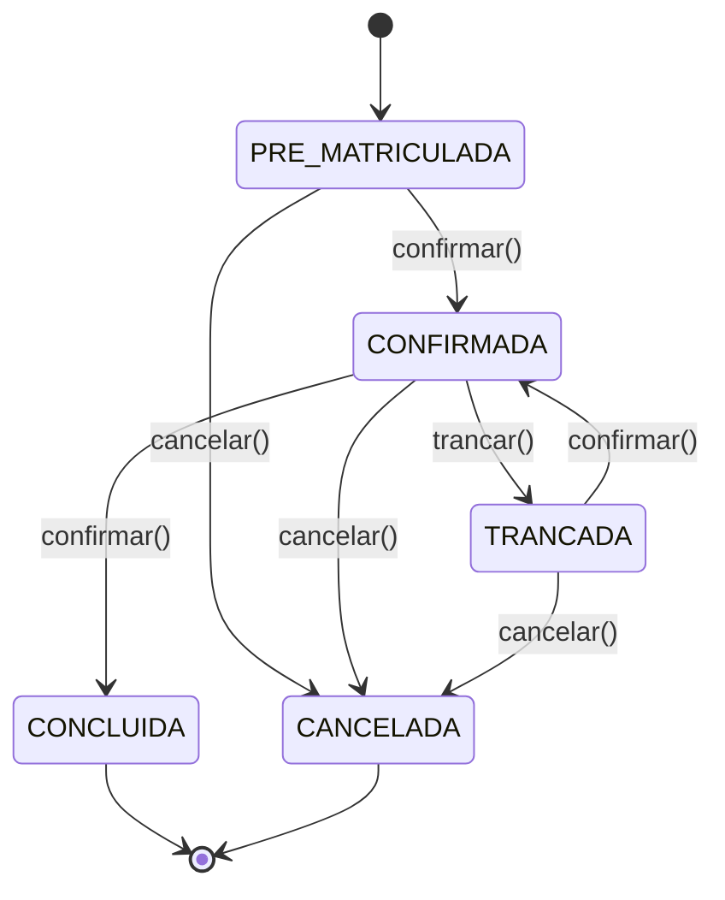

# TP2 — SIGA (Sistema de Gestão Acadêmica Simplificado)

Repositório da disciplina **Técnicas de Programação II** (CST em Desenvolvimento de Software Multiplataforma, Fatec de Porto Ferreira, Prof. Vagner dos Santos). Autor: Matheus Gabriel Bezerra Santos. Trabalho individual.

Este README responde, nesta ordem: 1) o que é o sistema, 2) para que serve, 3) como executar, 4) o que já faz e 5) o que não está pronto e quais são as limitações conhecidas. Depois vêm o diagrama, a documentação do código e o registro do commit da Aula 17.

## 1. O que é

O SIGA é um sistema acadêmico em **Java (JDK 17 ou superior)**, em modo console, sem interface gráfica e sem biblioteca externa. Ele não é um programa único: o repositório tem **uma pasta por aula** (`Aula1/` até `Aula13/` e a `prova-pratica-biblioteca/`), e cada pasta é uma versão do SIGA que compila e executa sozinha, com seu próprio `Main`. Em cada aula escolhi um problema do código fornecido, apliquei o conceito estudado (orientação a objetos, SOLID, padrões de projeto) e registrei o resultado.

## 2. Para que serve

Serve para mostrar, em código que executa, como cada conceito da disciplina resolve um problema concreto do domínio acadêmico: matrícula, desconto de mensalidade, cadastro de alunos, emissão de documentos e ciclo de vida da matrícula. O domínio é simples de propósito. O que importa é a estrutura do código: quem depende de quem e o que muda quando surge um requisito novo.

## 3. Como executar

Pré-requisito: JDK 17 ou superior (`java -version` para conferir). Cada pasta se compila e se executa de dentro dela. Exemplo com a `Aula13/`:

```bash
cd Aula13
javac -encoding UTF-8 -d out src/siga/*.java
java -cp out siga.Main
```

Para outra aula, troque o nome da pasta no `cd`. Os comandos são os mesmos em todas as pastas, e a saída esperada de cada uma está no `README.md` ou no `EVIDENCIAS.md` da própria pasta. Compilei e executei as onze pastas com JDK 21, em uma pasta de saída separada, e todas terminaram sem erro. As pastas geradas (`out/`, `bin/`) e a documentação gerada (`doc/`) não são versionadas (veja `.gitignore`).

## 4. O que já faz

| Pasta | Tema | O que o `Main` demonstra |
|---|---|---|
| [`Aula1/`](Aula1/) | Revisão de POO | `Pessoa`, `Aluno`, `Professor`, `Turma` e `Matricula`, com encapsulamento, herança e composição |
| [`Aula3/`](Aula3/) | SOLID (SRP, OCP, DIP) | Relatório de alunos separado em três classes; mensalidade com desconto por polimorfismo (`Desconto`); gravação por `MatriculaRepositorio` |
| [`Aula4/`](Aula4/) | UML em Mermaid | Só diagramas (`aula4-diagrama.md`); não tem código |
| [`Aula5/`](Aula5/) | Factory Method e Simple Factory | Painel inicial diferente para cada perfil de usuário, sem `if` no login |
| [`Aula6/`](Aula6/) | Abstract Factory, Builder e Singleton | Acesso a dados MySQL ou PostgreSQL por fábrica; consulta montada por `ConsultaBuilder`; `AcessoDados` com instância única |
| [`Aula7/`](Aula7/) | DAO | `ServicoMatricula` sem SQL; mesma regra com dois DAOs (`Map` e `List`) |
| [`Aula8/`](Aula8/) | CRUD completo | Cadastrar, consultar, listar, alterar e excluir aluno com validação e exceções definidas |
| [`Aula10/`](Aula10/) | Adapter e Facade | Importação de alunos de um serviço legado por adaptador; matrícula em uma única chamada (`FachadaMatricula`) |
| [`Aula11/`](Aula11/) | Decorator e Composite | Relatório com cabeçalho, numeração e marca d'água combináveis; estrutura curricular em módulos e disciplinas, com carga horária somada |
| [`Aula12/`](Aula12/) | Strategy e Observer | Mesmo desconto na matrícula e no boleto; reações à matrícula (e-mail, painel, auditoria, aviso, SMS) isoladas umas das outras |
| [`Aula13/`](Aula13/) | Template Method e State | Três documentos acadêmicos com um único esqueleto de emissão; ciclo de vida da matrícula em estados |
| [`prova-pratica-biblioteca/`](prova-pratica-biblioteca/) | Prova prática | Empréstimo de biblioteca, com adaptador para o acervo legado e estados do empréstimo |

## Diagrama

**Pergunta que o diagrama responde:** quais mudanças de situação uma matrícula pode fazer na `Aula13/`, e quais são proibidas?



Qualquer chamada que não esteja no diagrama lança `IllegalStateException` (por exemplo, `trancar()` em `PRE_MATRICULADA` ou qualquer chamada em `CONCLUIDA` e `CANCELADA`). Repare que `confirmar()` aparece em três transições com significados diferentes: confirma, conclui e retoma. Os motivos dessa escolha estão no [ADR-002](docs/adr/ADR-002-state-para-ciclo-de-vida-da-matricula.md).

## Documentação do código

- **Javadoc de contrato** nas interfaces e nos métodos públicos de serviço das Aulas 3, 5, 6, 7, 8, 10, 11, 12 e 13: o que cada método promete, exige, devolve e lança. Para gerar, de dentro de uma pasta: `javadoc -encoding UTF-8 -d doc -sourcepath src siga` (em todas as pastas roda sem erro). Exemplo do que o Javadoc diz e o nome não diz: `Desconto.aplicar` devolve o valor que o aluno **paga**, não o valor do desconto; `AcessoDados.conectar` usa o PostgreSQL para qualquer texto diferente de `"MYSQL"`.
- **Decisões de projeto** em `docs/adr/`:
  - [ADR-001 — DAO para acesso a dados](docs/adr/ADR-001-dao-para-acesso-a-dados.md)
  - [ADR-002 — State para o ciclo de vida da matrícula](docs/adr/ADR-002-state-para-ciclo-de-vida-da-matricula.md)
- **Evidências por aula:** `EVIDENCIAS.md` nas Aulas 1, 3, 5, 6 e 7. As demais pastas registram as evidências no próprio `README.md` ou em arquivos de saída (`evidencias/`).

## 5. O que não está pronto e limitações conhecidas

- **Não existe a Aula 9.** Não há pasta `Aula9/` no repositório; a linha dessa aula na tabela antiga do README estava sem tema e apontava para uma pasta inexistente, então a retirei.
- **Não há testes automatizados.** O repositório não tem JUnit nem pasta de testes. A verificação de cada aula é a saída do `Main`, conferida por mim.
- **O SIGA não é um projeto único.** Cada pasta é uma cópia independente: `Aluno`, `Matricula` e outras classes existem em versões diferentes em várias pastas, e uma correção feita em uma não chega às outras. Esse é o maior limite do repositório.
- **Nada é persistido de verdade.** Os DAOs guardam em memória, `BancoSimulado` e `GravadorMySQL` só imprimem no console, e o e-mail e o SMS também. Ao fim do programa, nenhum dado sobrevive.
- **Regras incompletas na matrícula da `Aula10/`:** o CPF é aceito se tiver 11 dígitos (os dígitos verificadores não são calculados), a fachada não impede a matrícula de aluno inativo nem a duplicada, e, se a notificação falhar depois da gravação, a matrícula e a vaga ficam efetivadas, sem desfazer. As vagas das turmas são fixas no código (`DSM-2A` com 2 e `DSM-2B` com 0).
- **As duas versões do DAO divergem na `Aula7/`:** com matrícula repetida ou inexistente, `AlunoDAOMemoria` e `AlunoDAOLista` se comportam de forma diferente. A `Aula8/` corrige com exceções, mas só a implementação em memória foi refeita.
- **`Aula6/`:** `AcessoDados.conectar` usa o PostgreSQL para qualquer texto diferente de `"MYSQL"`, inclusive erro de digitação, e o Singleton não é seguro para várias threads.
- **`Aula12/`:** quem informa se a turma lotou é o código que chama a fachada; nenhuma classe controla vagas. Os descontos não se acumulam (vale um só, na ordem bolsista, servidor, egresso).
- **`Aula13/`:** o ciclo de vida usa `confirmar()` também para concluir a matrícula (decisão consciente, explicada no ADR-002) e não guarda o histórico de mudanças. `LogAcademico` é uma lista estática compartilhada por todo o programa.
- **Javadoc não cobre** as Aulas 1 e a prova prática, nem os getters, os setters e os métodos privados.

## Aula 17 — commit que altera código e documentação juntos

| Item | Valor |
|---|---|
| Commit | `PREENCHER_HASH` |
| Arquivos alterados | 34 |
| O que mudou | Javadoc de contrato em 29 arquivos `.java`; novo `README.md`; `docs/adr/` com dois ADRs; `.gitignore` com `out/` e `doc/`; link do `Aula4/README.md` corrigido |

A contagem vem de `git show --stat` desse commit. Registrei o hash em um commit seguinte, porque um commit não consegue citar o próprio identificador.
